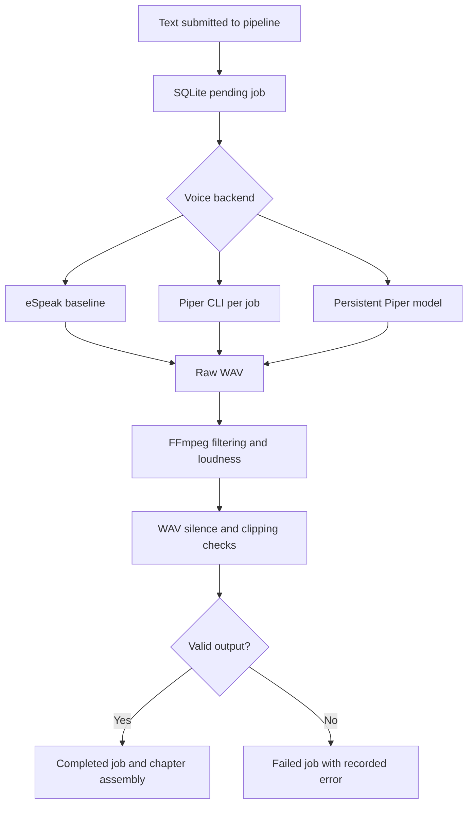

# Neural Audiobook Voice Production Pipeline

A runnable Python audiobook-narration pipeline with **Piper neural text-to-speech**, persistent ONNX model inference, FFmpeg post-processing, SQLite job tracking, chapter assembly, and waveform checks.

> **Scope:** local engineering project, not a deployed Audible service. The default FastAPI application uses eSpeak. Piper is exercised by the neural benchmark or by explicitly constructing a `Pipeline(..., neural_engine=PersistentPiperEngine(...))`. Silence/clipping checks do not measure perceived voice naturalness.

## Measured optimization

Loading the neural model once and reusing it across sequential synthesis jobs reduced processing time compared with launching a new Piper CLI process for every job.

| Run | Processing-time reduction | Throughput speedup |
| --- | ---: | ---: |
| 1 | 72.88% | 3.688× |
| 2 | 73.25% | 3.738× |
| 3 | 59.14% | 2.447× |
| **Arithmetic mean** | **68.42%** | **3.291×** |

Each comparison used 20 sequential text segments on a local Windows machine, including FFmpeg processing and waveform quality checks. This is **not** proof of faster speech than eSpeak, concurrent-load scalability, word accuracy, or better perceptual naturalness. Hardware, model initialization, repeated sentences, and test order affect results. The third run's full measured JSON is in `results/piper_optimization.json`.

## Architecture



See [architecture and failure handling](docs/ARCHITECTURE.md) and [benchmark methodology](docs/BENCHMARKS.md).

## Requirements

- Python 3.10+ and `pip`
- FFmpeg and eSpeak NG installed on PATH; on Windows, the baseline currently expects an `espeak` command
- `pip install -r requirements.txt`
- For neural runs: the Piper `en_US-lessac-medium.onnx` model and matching `.onnx.json`, placed under `models/`, downloaded separately from the [Piper voice collection](https://huggingface.co/rhasspy/piper-voices/tree/main/en/en_US/lessac/medium)

Model weights, generated audio, local databases, and Python caches are deliberately not committed. Check each downloaded model's license independently.

## Try it locally

```bash
python -m pytest -q tests
python -m voice_production.cli --text "Once upon a time, a new story began."
uvicorn voice_production.api:app --reload
```

Visit `http://127.0.0.1:8000/docs` for interactive API documentation. The API defaults to eSpeak; it does not automatically switch to the neural engine.

## Real neural performance comparison

```bash
python -X utf8 -m benchmarks.compare_optimized --model models/en_US-lessac-medium.onnx --jobs 20
```

Saves `results/piper_optimization.json`. On Windows, setting `PYTHONUTF8=1` can also avoid `charmap` decoding errors when reading subprocess output.

## Project layout

- `voice_production/` — job pipeline, FastAPI interface, and neural engines
- `benchmarks/` — real synthesis and model-reuse comparison
- `tests/` — automated correctness and adapter tests
- `docs/` — architecture, validation, limitations, and reproducibility
- `results/` — sample locally measured optimization output

## Engineering limitations

The pipeline is designed for local demonstration: SQLite persistence and filesystem WAV output, synchronous job processing, no distributed queue, and no authenticated production API. The concurrency and retry paths are not a substitute for production scheduling, idempotent claiming, rate limiting, observability, or security controls.

**Resume-safe claim:** “Optimized Piper neural speech synthesis by reusing an in-memory ONNX model, reducing processing time by 68% on average across three local 20-job benchmarks.”
