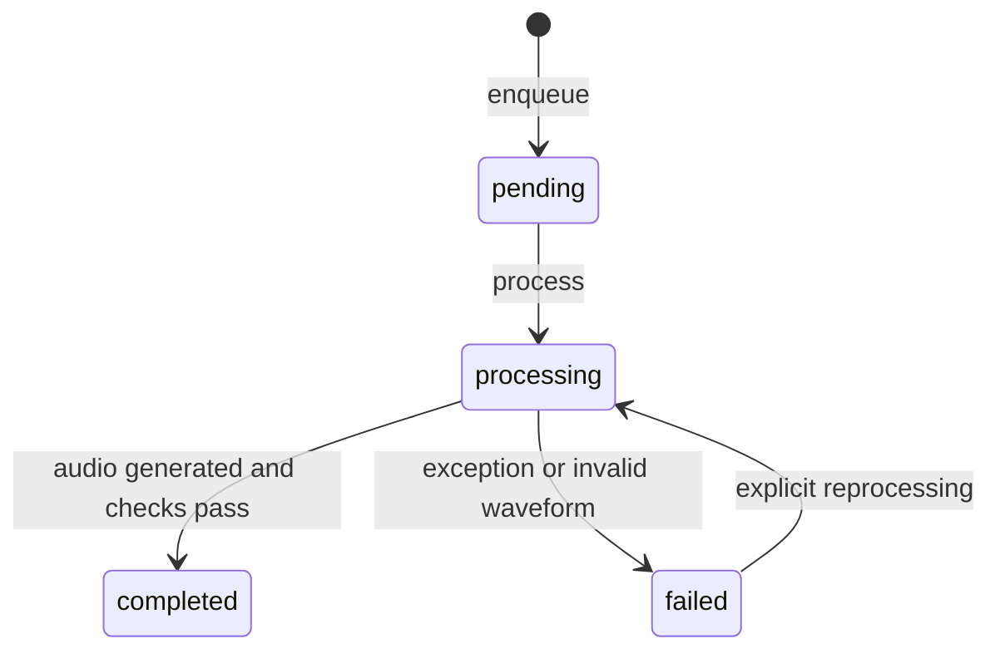

# Software architecture and failure handling

## Request path

The FastAPI `POST /jobs` endpoint validates chapter/text input, calls `Pipeline.enqueue`, and persists a pending job in SQLite. `POST /jobs/process` processes queued and failed jobs with a local thread pool. `GET /jobs/{id}` returns persisted state, and `GET /jobs/{id}/audio` serves completed WAV output. `POST /chapters/{chapter}/assemble` concatenates successful segments. This API currently initializes `Pipeline` **without** a neural engine, so it uses eSpeak by default.

## Neural path

The benchmark creates `Pipeline(root, neural_engine=...)` with one of two engines. `PiperEngine` launches a Piper CLI subprocess for each segment. `PersistentPiperEngine` loads the voice once using `PiperVoice.load`, keeps it in memory, serializes inference with a lock, and writes PCM WAV. Both engines flow into FFmpeg's filtering and loudness normalization and the same waveform QC.

## State flow

SQLite stores job IDs, chapter, text, status, attempts, output path, error text, duration and timestamps. Exceptions are recorded against the job; a failed job can be attempted again by `process_pending`. The code currently does **not** implement exponential backoff, max-attempt limits, distributed atomic job claiming, or exactly-once processing.

## Validation

Input text must be nonempty and at most 10,000 characters. Generated WAV is checked for nonzero duration, an RMS-based silence threshold, and PCM clipping. These tests cannot detect wrong words, hallucinations, weak prosody, accent issues, or intelligibility defects. A human listening study or transcription-based evaluation would be needed.

## Production-hardening roadmap

For a multi-instance service: replace local SQLite queue scans with durable leased jobs, store WAV in object storage, add authenticated access and chapter ownership checks, enforce quotas and timeouts, introduce structured metrics/tracing, and add idempotent output publishing and replay-safe retries.
